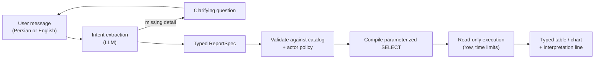

# SageQL

[](https://github.com/SinaQP/SageQL/actions/workflows/compatibility.yml)

[](LICENSE)

**Chat-driven reporting you can embed in a backend, where the language model never
writes SQL.**

A manager asks «ساعات فعالیت روزانه در سپتامبر ۲۰۲۶» ("daily activity hours in
September 2026") or the English equivalent. SageQL turns the request into a typed
report specification, checks it against the host's registered catalog and the
user's access policy, and compiles a parameterized, read-only `SELECT` itself. The
host gets back a typed table or chart payload. Persian is the default language;
English is fully supported.

## Why models never write SQL

Most text-to-SQL tools let the model write a query and then try to guard it.
That leaves the hardest problems with the model: picking join keys, applying
tenant filters, avoiding exfiltration through clever SQL. SageQL moves the trust
boundary:

| The model does | Deterministic code does |
|---|---|
| Extract intent: measures, groupings, period, filters, ranking | Authorize every dataset, column and row policy for the actor |
| Ask a clarifying question when something material is missing | Resolve dates and Jalali months locally, look up entity names |
| | Compile parameterized SQL for SQL Server or SQLite and run it read-only, with row and time limits |

The model never sees result rows and never names a table or join it was not
given. A wrong interpretation produces a wrong *report*, which is shown to the
user as a plain-language interpretation line. It cannot produce an unauthorized
*query*.



## Results

Measured on frozen synthetic multi-turn conversations (27 scored reports, low
reasoning effort; [full comparison](docs/MODEL_COMPARISON_NANO_MINI.md)):

| Setup | Correct reports | Model calls / 40 turns | Median turn |
|---|---:|---:|---:|
| `gpt-5-nano` for every stage | 8/27 | 76 | 8–21 s |
| `gpt-5-mini` intent, nano planner and reviewer | 15/27 | 87 | 16–21 s |
| **`gpt-5-mini` intent, locally compiled spec, no reviewer** | **22/27** | **34** | **~7 s** |

Compiling a complete intent into the report spec locally, instead of asking a
second model to plan it, removed more than half the model calls and roughly
tripled accuracy over the nano baseline. Remaining failures are intent
extraction mistakes (a lost filter, a wrong period or limit); see the
[roadmap](docs/ROADMAP.md) for the next steps. The deterministic side is covered
by about 2,200 offline tests that run in CI on Linux and Windows, Python 3.10–3.15.

## Quickstart (offline, no API key)

```bash
git clone https://github.com/SinaQP/SageQL.git && cd SageQL
python -m venv .venv && . .venv/bin/activate   # Windows: .venv\Scripts\activate
pip install -e ".[dev]"
python examples/sdk_demo.py        # Persian three-turn conversation on synthetic data
python examples/web/server.py --demo   # chat UI at http://127.0.0.1:8765
```

Both use synthetic SQLite data and a scripted interpreter, so they make no
network calls. In the web demo, ask «ساعات فعالیت روزانه در سپتامبر», answer
«۲۰۲۶», then say «به تفکیک کارمند نمایش بده» ("break it down by employee").

## Embedding it

The host registers what may be reported on and who may see what; SageQL does the
rest. A condensed version of [examples/sdk_demo.py](examples/sdk_demo.py):

```python
from sageql import Column, SageQL, Table
from sageql.sdk import (AccessScope, DatasetAccess, DatasetDefinition, DimensionDefinition,
                        MetricDefinition, ReportingCatalog, RowPolicy, SQLiteAdapter,
                        SQLiteSessionStore, TimeDefinition)

table = Table("activities")
catalog = ReportingCatalog((DatasetDefinition(
    "activities", "Activities", table,
    tuple(Column(table.key, name, kind) for name, kind in (
        ("tenant_id", "int"), ("employee", "text"), ("activity_date", "date"), ("hours", "decimal"))),
    metrics=(MetricDefinition("activity_hours", "Activity hours", "sum", "hours", "h"),),
    dimensions=(DimensionDefinition("employee", "Employee", "employee"),),
    time=TimeDefinition("activity_date"),
),))

def policy(actor):  # every query is bound to the caller's tenant
    return AccessScope((DatasetAccess("activities", policies=(
        RowPolicy("tenant_id", "eq", (int(actor.tenant_id),)),)),))

engine = SageQL(catalog=catalog, database=SQLiteAdapter("data.sqlite"), provider=my_provider,
                policy=policy, sessions=SQLiteSessionStore("sessions.sqlite"),
                execution="validated")
session = engine.create_session(actor)  # actor comes from the host's authentication
reply = engine.submit(session.session_id, "daily activity hours in September 2026",
                      actor, "request-1", session.revision)
```

Sessions support clarification, refinement ("now group it by employee"),
revision checks, idempotent retries and saved reports that re-run with zero model
calls. SQL Server is the production target; SQLite is the offline reference.

## Documentation

- [Embedding guide](docs/SDK.md) and [architecture](docs/ARCHITECTURE.md)
- [Agents and model settings](docs/SDK_AGENTS.md), [reliability](docs/SDK_RELIABILITY.md)
- [SQL Server execution](docs/SDK_SQL_SERVER.md), [read consistency](docs/SDK_READ_CONSISTENCY.md)
- [Relationships](docs/SDK_RELATIONSHIPS.md), [entity lookups](docs/SDK_ENTITY_LOOKUPS.md),
  [Jalali months](docs/SDK_JALALI_MONTHS.md), [saved reports](docs/SDK_SAVED_REPORTS.md)
- [Full capability list](docs/CAPABILITIES.md), [testing](docs/SQLITE_FIRST_TESTING.md),
  [evaluations](evaluations/README.md), [roadmap](docs/ROADMAP.md)

**Out of scope by design:** model-written SQL, model-selected joins, arbitrary
formulas, database writes. Production authentication belongs to the host.

## Detailed guides

The sections below cover the reference hosts, the earlier staged CLI and the
lower-level Python API.

## Try the embedded report flow

The following offline commands exercise the same SDK using synthetic data and a scripted interpreter:

```powershell
python -m venv .venv
.\.venv\Scripts\python.exe -m pip install -e ".[openai,odbc,dev]"
.\.venv\Scripts\python.exe examples/sdk_demo.py
.\.venv\Scripts\python.exe examples/multi_domain.py
.\.venv\Scripts\python.exe examples/web/server.py --demo
```

Open `http://127.0.0.1:8765`, ask «ساعات فعالیت روزانه در سپتامبر», answer «۲۰۲۶», then request «به تفکیک کارمند نمایش بده». English versions of these requests also work. This uses synthetic data and a deterministic interpreter without credentials or remote calls. The [frontend guide](examples/web/README.md) also covers SQL Server mode. The first SDK slice queries one registered table/view per dataset; reviewed reporting views can contain business joins. Model-selected joins, arbitrary formulas, timestamp conversion, calendars beyond the explicit Jalali month extension and production authentication are outside this slice. The scripted offline demo does not interpret Persian month names; the configured model host supports the extension.

Registered dimension-only reports can list employee names without adding an aggregate. The sections below document the earlier staged workflow. Its experimental model-written SQL API is separate from the SDK engine.

The [application integration guide](docs/APPLICATION_INDEPENDENCE.md) documents
the reviewed boundaries and executable retail/library fixtures. Each host supplies
its own schema, business definitions, relationships and authenticated policies.
The same SDK produces sales totals, borrowing counts and loan-duration reports;
single-column product names/book titles and multi-column personal names use the
same bounded lookup contract. The offline examples use scripted providers.

Rahtal also resolves a supplied employee full name before filtering daily
activity reports. The host registers this lookup explicitly; users do not need
an employee ID. Duplicate names ask for job position, and each policy-bound read
still queries one source without joins. See the [lookup scope](docs/SDK_ENTITY_LOOKUPS.md).

Grouped activity reports and employee rankings can also display full names using
a host-registered `EntityLabelDimension`. The SDK ranks identities first, then
fetches names locally under profile policies; duplicate profiles cannot multiply
hours and names never enter model context. See the [display-label scope](docs/SDK_ENTITY_LABELS.md).

## Inspect planning, SQL, validation, and execution without an API key

Run the deterministic example to see a checked plan, parameterized SQL, validation results, and rows from a synthetic SQLite database:

```powershell
python -m venv .venv
.\.venv\Scripts\python.exe -m pip install -e .
.\.venv\Scripts\python.exe main.py --plan-demo
```

The output lists operations, `PASS` and `REVIEW` checks, generated SQLite SQL and parameters, then two result rows. This mode uses the synthetic schema and fixed proposal in [main.py](main.py). It creates a temporary database, executes through the same read-only path as the public API, and removes the file afterward. It needs no model or credentials. Run `.\.venv\Scripts\python.exe -m pytest -q` to check valid and rejected plans.

## Run from `main.py`

Python 3.10 or newer is required. In PowerShell, from this repository:

```powershell
python -m venv .venv
.\.venv\Scripts\python.exe -m pip install -e ".[openai]"
Copy-Item .env.example .env
notepad .env
.\.venv\Scripts\python.exe main.py --example
```

Put your API key in the `LLM_API_KEY` field of `.env`. The example contains the AvalAI Base URL and `gpt-5-nano` model. `main.py --example` runs `EXAMPLE_QUESTION` through the public API using the inline `EXAMPLE_SCHEMA` dictionary, then prints the plan, generated SQLite SQL, and validation. Edit those two values in [main.py](main.py) to try your own case. The fixed example binds calendar year 2025 as `2025-01-01` through the exclusive end `2026-01-01`. It does not execute because no real database file is supplied. `.env` is ignored by Git, and existing shell environment variables take precedence over the file. The OpenAI extra is unnecessary for offline tests or a custom provider.

## Start a report conversation

Without `--example`, the main file starts the interactive CLI. It asks for your report question first, then uses the configuration from `.env` and prompts for missing fields. Run it with your catalog:

```powershell
.\.venv\Scripts\python.exe main.py --catalog my-schema.json
```

You can also run the installed CLI directly if you set environment variables yourself:

```powershell
sageql chat
```

The CLI first asks what report you want. It then collects these fields:

| Database | LLM |
| --- | --- |
| Server / Host | API Key |
| Database | Base URL |
| Authentication method | Model |
| ODBC Driver | |

If the request is unclear, answer the AI's clarification question at `You>`. Once understood, the program prints `Request understanding:` and resolves five context fields: time period, entities, metrics, filters, and comparison period. It asks another focused question if a material context detail is missing. A time period is required; “all available data” is a valid answer. Empty optional filters and comparison periods print as `Not specified`. Relative phrases such as “last quarter” are preserved, not converted to exact dates. Step 4 loads the catalog; Step 6 prints the plan; Step 7 prints SQLite SQL; Step 8 prints validation results. Step 9 runs only when you pass `--execute-sqlite`. Unresolved dates appear as required `:period_start` and `:period_end` bindings and block execution. Step 5 has not been defined. Type `/exit` to stop early. Use `--no-discovery`, `--no-planning`, or `--no-sql` to stop at an earlier step. Without environment overrides, the Base URL defaults to `https://api.openai.com/v1` and the model to `gpt-5-nano`. A custom Base URL receives your API key, so use an endpoint you trust.

Supply the catalog path with `--catalog path/to/schema.json`, set `SCHEMA_CATALOG_PATH` in `.env`, or enter the path when prompted after context resolution. Without `--execute-sqlite`, the CLI prints SQL and validation but does not open a database connection. If the model returns an invalid logical plan, planning can request one corrected proposal using validator feedback. The corrected proposal must pass the same checks before SQL generation or execution.

### Execute on a SQLite file

For a file whose tables match your catalog, provide exact date bounds and an explicit database path:

```powershell
.\.venv\Scripts\python.exe main.py --catalog schema.example.json `
  --period-start 2025-01-01 --period-end 2026-01-01 `
  --execute-sqlite path\to\your.sqlite `
  --sqlite-schema sales=path\to\your.sqlite
```

The sample catalog uses the `sales` schema name, so the command maps that name to a SQLite file. Omit `--sqlite-schema` for unqualified tables; repeat it for separate named schema files. The date end is exclusive. For comparisons, also pass `--comparison-start` and `--comparison-end`. The default result limit is 50 rows; set `--max-rows` up to 10,000. SageQL marks truncated results. It enforces a five-second and one-million-step query limit. These flags execute only SQLite SQL; the configured ODBC host, database, authentication, and driver are not used for this path.

### Schema catalog format

See [schema.example.json](schema.example.json) for a runnable synthetic example. The top-level `tables` array is required. Each table needs a `name` and nonempty `columns` array. `schema`, `kind` (`TABLE` or `VIEW`), and `description` are optional. Each column needs a `name`; `data_type`, `nullable`, and `description` are optional. An omitted data type is recorded as `unknown`. `relations` and `definitions` are optional:

```json
{
  "tables": [
    {
      "schema": "sales",
      "name": "orders",
      "columns": [
        {"name": "amount", "data_type": "decimal"},
        {"name": "ordered_at", "data_type": "date"}
      ]
    }
  ],
  "definitions": [
    {"term": "revenue", "meaning": "Define revenue for your own database here."}
  ]
}
```

For a relation, add `name`, `child_table`, `child_columns`, `parent_table`, and `parent_columns` as shown in the example file. Table references use `schema.table` (or just `table` when no schema is supplied). The arrays of child and parent columns must line up positionally. The parser rejects missing references, duplicate names, unexpected fields, and malformed JSON. It does not check whether supplied names match a real database yet.

Send at most 30 relevant tables, 500 total columns, 150 relations, and 200 definitions to one discovery request. SageQL rejects a larger candidate set rather than silently omitting supplied objects.

For the tested AvalAI configuration, set the non-secret defaults and let the CLI ask for the key privately:

```powershell
$env:LLM_BASE_URL = "https://api.avalai.ir/v1"
$env:LLM_MODEL = "gpt-5-nano"
sageql chat
```

## Python API

```python
import os

from dotenv import load_dotenv
from sageql import (
    ChatConfig,
    ContextResolutionSession,
    DatabaseConfig,
    LLMConfig,
    RequestUnderstandingSession,
    load_catalog_file,
    discover_query_space,
    create_query_plan,
    review_query_plan,
    prepare_report_query,
    execute_sqlite_report,
)
from sageql.chat_provider import OpenAIChatProvider

load_dotenv()
database = DatabaseConfig(
    server_host="not-connected",
    database="example",
    authentication="not-used",
    odbc_driver="not-used",
)
llm = LLMConfig(
    api_key=os.environ["LLM_API_KEY"],
    base_url=os.environ.get("LLM_BASE_URL", "https://api.openai.com/v1"),
    model=os.environ.get("LLM_MODEL", "gpt-5-nano"),
)
config = ChatConfig(database=database, llm=llm)
provider = OpenAIChatProvider(llm)
conversation = RequestUnderstandingSession(config, provider)
assessment = conversation.submit(
    "Create a monthly report for 2025 showing the sum of sales.orders.amount "
    "grouped by sales.regions.name, using all orders and no comparison period."
)
while not assessment.enough_information:
    print(assessment.clarification_question)
    assessment = conversation.submit(input("You> "))
print("Request understanding:", assessment.request_understanding)

context_session = ContextResolutionSession(
    config, provider, conversation.history, assessment.request_understanding
)
resolution = context_session.start()
while not resolution.ready:
    print(resolution.clarification_question)
    resolution = context_session.submit(input("You> "))
print("Resolved context:", resolution.context)

catalog = load_catalog_file("schema.example.json")
space = discover_query_space(catalog, provider, assessment.request_understanding, resolution.context)
print("Tables:", [table.key for table in space.tables])
print("Columns:", [column.key for column in space.columns])
print("Relations:", [relation.name for relation in space.relations])
print("Definitions:", [definition.term for definition in space.definitions])

plan = create_query_plan(
    assessment.request_understanding, resolution.context, space, provider
)
quality = review_query_plan(plan, resolution.context, space)
print("Operations:", plan.operations())
print("Structural checks:", quality.checks_passed)
print("Review before SQL:", quality.review_items)

prepared = prepare_report_query(
    plan, resolution.context, space, period_bounds=("2025-01-01", "2026-01-01")
)
print("SQLite SQL:\n", prepared.query.sql)
print("Bind parameters:", dict(prepared.query.parameters))
print("Validation:", prepared.validation.checks_passed, prepared.validation.review_items)

# After supplying a real SQLite file whose tables match the catalog:
# result = execute_sqlite_report(
#     "path/to/your.sqlite", prepared.query, plan, resolution.context, space,
#     attached_schemas={"sales": "path/to/your.sqlite"},
# )
# print(result.columns, result.rows, result.truncated)
```

`conversation.history` contains successful user and assistant turns. You can inject another object with `assess(messages)`, `resolve_context(messages, understanding)`, `select_query_space(understanding, context, candidates)`, and `propose_query_plan(understanding, context, candidates)` methods to use a different provider or test offline.

## Current scope and privacy

- Conversation messages, request understanding, resolved context, and bounded user-supplied schema metadata go to the configured LLM endpoint. Planning sends the selected query space. Database host, database name, authentication method, ODBC driver, and credentials stay local. Do not use a model endpoint that should not see your schema names or descriptions.
- Context fields are the model's interpretation of the request. Step 4 verifies selected names against the supplied catalog. In Step 6 the model selects resolved metrics and filters by temporary IDs; SageQL restores their original phrases and validates references, joins, metric/filter coverage, and basic type/time-grain compatibility. If the request explicitly asks for all base-table rows, an inner join is changed to a left join and the repair is shown. Step 7 renders the plan deterministically. Step 8 checks the SELECT statement, selected tables/columns, required filters, explicit interpretation facts, and exact agreement with the plan. A bad SQL candidate is discarded and regenerated once with `prepare_report_query`; unresolved dates and missing required filters block execution. These checks cannot prove ambiguous business meaning, join cardinality, or that the supplied catalog matches the live file. Review those choices and use `RequiredFilter` in the Python API for mandatory tenant or policy conditions.
- The API key is hidden at the CLI prompt and masked in `LLMConfig` representations. Historical CLI history stays in memory. SDK stores explicitly persist messages and report rows under host-controlled permissions and retention.
- Definitions come from user-supplied descriptions and glossary entries. Relations come from user-supplied relation entries. SageQL does not invent business definitions or joins.
- The general CLI executes only with `--execute-sqlite`. It opens files with SQLite `mode=ro`, validates again, restricts reads with an authorizer, and caps returned rows and work. Filter and date values are bind parameters. A comparison-period operation yields labeled rows, while alignment and delta calculation still need definition. The separate Rahtal pilot supports its approved SQL Server scope; arbitrary ODBC schemas are not supported by that runner.
- The earlier experimental SQLite SQL proposal command is still available as `sageql "question" --schema schema.sql`, but it is separate from the report conversation.

## Development

Read [`agent-rules/Agent.md`](agent-rules/Agent.md) for the AI development workflow and [`docs/ROADMAP.md`](docs/ROADMAP.md) for the implementation slices.

```powershell
python -m pip install -e ".[dev]"
python -m pytest
python -m build
```

Live model comparisons are separately approved runs of the shared evaluation
runner; see `python -m evaluations.model_comparison --help` and
[the latest results](docs/MODEL_COMPARISON_NANO_MINI.md). Ordinary tests and
offline runs make no external model calls.
