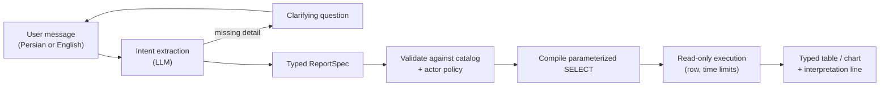

# SageQL

[](https://github.com/SinaQP/SageQL/actions/workflows/compatibility.yml)
[](https://pypi.org/project/sageql/)
[](https://sinaqp.github.io/SageQL/)

[](https://github.com/SinaQP/SageQL/blob/main/LICENSE)

**Chat-driven reporting you can embed in a backend, where the language model never
writes SQL.**

A manager asks «ساعات فعالیت روزانه در سپتامبر ۲۰۲۶» ("daily activity hours in
September 2026") or the English equivalent. SageQL turns the request into a typed
report specification, checks it against the host's registered catalog and the
user's access policy, and compiles a parameterized, read-only `SELECT` itself. The
host gets back a typed table or chart payload. Persian is the default language;
English is fully supported.

**[See it work →](https://sinaqp.github.io/SageQL/)** Recorded example conversations, each
showing what the model received and returned, the SQL SageQL wrote and the result.

## Why models never write SQL

Most text-to-SQL tools let the model write a query and then try to guard it.
That leaves the hardest problems with the model: picking join keys, applying
tenant filters, avoiding exfiltration through clever SQL. SageQL moves the trust
boundary:

| The model does | Deterministic code does |
|---|---|
| Extract intent: measures, groupings, period, filters, ranking | Authorize every dataset, column and row policy for the actor |
| Ask a clarifying question when something material is missing | Resolve dates and Jalali months locally, look up entity names |
| | Compile parameterized SQL for SQL Server or SQLite and run it read-only, with row and time limits |

The model never sees result rows and never names a table or join it was not
given. A wrong interpretation produces a wrong *report*, which is shown to the
user as a plain-language interpretation line. It cannot produce an unauthorized
*query*.



## Results

Measured on frozen synthetic multi-turn conversations (27 scored reports, low
reasoning effort; [full comparison](https://github.com/SinaQP/SageQL/blob/main/docs/MODEL_COMPARISON_NANO_MINI.md)):

| Setup | Correct reports | Model calls / 40 turns | Median turn |
|---|---:|---:|---:|
| `gpt-5-nano` for every stage | 8/27 | 76 | 8–21 s |
| `gpt-5-mini` intent, nano planner and reviewer | 15/27 | 87 | 16–21 s |
| **`gpt-5-mini` intent, locally compiled spec, no reviewer** | **22/27** | **34** | **~7 s** |

Compiling a complete intent into the report spec locally, instead of asking a
second model to plan it, removed more than half the model calls and roughly
tripled accuracy over the nano baseline. Remaining failures are intent
extraction mistakes (a lost filter, a wrong period or limit); see the
[roadmap](https://github.com/SinaQP/SageQL/blob/main/docs/ROADMAP.md) for the next steps. The deterministic side is covered
by about 2,500 offline tests that run in CI on Linux and Windows, Python 3.10–3.15.

## Install

```bash
pip install sageql                  # core: SQLite adapter, compiler, sessions
pip install "sageql[openai,odbc]"   # OpenAI-compatible agents and SQL Server
```

## Quickstart (offline, no API key)

```bash
pip install sageql
sageql demo
```

`sageql demo` runs a Persian three-turn conversation (a question, a clarifying
answer, a refinement) through the real engine on synthetic data. It prints each
reply, the report tables and the parameterized SQL SageQL compiled, with the
caller's tenant bound as a parameter. `sageql demo --json` prints the full reply
contract a host receives.

For the chat UI, clone the repository:

```bash
git clone https://github.com/SinaQP/SageQL.git && cd SageQL
python -m venv .venv && . .venv/bin/activate   # Windows: .venv\Scripts\activate
pip install -e ".[dev]"
python examples/web/server.py --demo   # chat UI at http://127.0.0.1:8765
```

Both demos use synthetic SQLite data and a scripted interpreter, so they make no
network calls. In the web demo, ask «ساعات فعالیت روزانه در سپتامبر», answer
«۲۰۲۶», then say «به تفکیک کارمند نمایش بده» ("break it down by employee").

## Embedding it

The host registers what may be reported on and who may see what; SageQL does the
rest. A condensed version of [the demo](https://github.com/SinaQP/SageQL/blob/main/src/sageql/demo.py):

```python
from sageql import Column, SageQL, Table
from sageql.sdk import (AccessScope, DatasetAccess, DatasetDefinition, DimensionDefinition,
                        MetricDefinition, ReportingCatalog, RowPolicy, SQLiteAdapter,
                        SQLiteSessionStore, TimeDefinition)

table = Table("activities")
catalog = ReportingCatalog((DatasetDefinition(
    "activities", "Activities", table,
    tuple(Column(table.key, name, kind) for name, kind in (
        ("tenant_id", "int"), ("employee", "text"), ("activity_date", "date"), ("hours", "decimal"))),
    metrics=(MetricDefinition("activity_hours", "Activity hours", "sum", "hours", "h"),),
    dimensions=(DimensionDefinition("employee", "Employee", "employee"),),
    time=TimeDefinition("activity_date"),
),))

def policy(actor):  # every query is bound to the caller's tenant
    return AccessScope((DatasetAccess("activities", policies=(
        RowPolicy("tenant_id", "eq", (int(actor.tenant_id),)),)),))

engine = SageQL(catalog=catalog, database=SQLiteAdapter("data.sqlite"), provider=my_provider,
                policy=policy, sessions=SQLiteSessionStore("sessions.sqlite"),
                execution="validated")
session = engine.create_session(actor)  # actor comes from the host's authentication
reply = engine.submit(session.session_id, "daily activity hours in September 2026",
                      actor, "request-1", session.revision)
```

Sessions support clarification, refinement ("now group it by employee"),
revision checks, idempotent retries and saved reports that re-run with zero model
calls. SQL Server is the production target; SQLite is the offline reference.

## Documentation

- [Embedding guide](https://github.com/SinaQP/SageQL/blob/main/docs/SDK.md) and [architecture](https://github.com/SinaQP/SageQL/blob/main/docs/ARCHITECTURE.md)
- [Agents and model settings](https://github.com/SinaQP/SageQL/blob/main/docs/SDK_AGENTS.md), [reliability](https://github.com/SinaQP/SageQL/blob/main/docs/SDK_RELIABILITY.md)
- [SQL Server execution](https://github.com/SinaQP/SageQL/blob/main/docs/SDK_SQL_SERVER.md), [read consistency](https://github.com/SinaQP/SageQL/blob/main/docs/SDK_READ_CONSISTENCY.md)
- [Relationships](https://github.com/SinaQP/SageQL/blob/main/docs/SDK_RELATIONSHIPS.md), [entity lookups](https://github.com/SinaQP/SageQL/blob/main/docs/SDK_ENTITY_LOOKUPS.md),
  [Jalali months](https://github.com/SinaQP/SageQL/blob/main/docs/SDK_JALALI_MONTHS.md), [saved reports](https://github.com/SinaQP/SageQL/blob/main/docs/SDK_SAVED_REPORTS.md)
- [Full capability list](https://github.com/SinaQP/SageQL/blob/main/docs/CAPABILITIES.md), [testing](https://github.com/SinaQP/SageQL/blob/main/docs/SQLITE_FIRST_TESTING.md),
  [evaluations](https://github.com/SinaQP/SageQL/blob/main/evaluations/README.md), [roadmap](https://github.com/SinaQP/SageQL/blob/main/docs/ROADMAP.md)

**Out of scope by design:** model-written SQL, model-selected joins, arbitrary
formulas, database writes. Production authentication belongs to the host.

**Legacy:** the staged 0.1 CLI and Python API (including an experimental command
where a model writes SQLite SQL) are separate from the SDK. They now live in
`sageql.legacy` and `sageql legacy …`; see [the legacy guide](https://github.com/SinaQP/SageQL/blob/main/docs/LEGACY.md).

## Development

Read [`agent-rules/Agent.md`](https://github.com/SinaQP/SageQL/blob/main/agent-rules/Agent.md) for the AI development workflow and [`docs/ROADMAP.md`](https://github.com/SinaQP/SageQL/blob/main/docs/ROADMAP.md) for the implementation slices.

```powershell
python -m pip install -e ".[dev]"
python -m pytest
python -m build
```

Live model comparisons are separately approved runs of the shared evaluation
runner; see `python -m evaluations.model_comparison --help` and
[the latest results](https://github.com/SinaQP/SageQL/blob/main/docs/MODEL_COMPARISON_NANO_MINI.md). Ordinary tests and
offline runs make no external model calls.
