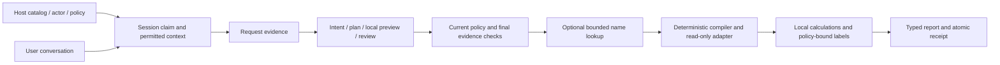

# Phase 01 engineering audit and evaluation baseline

Date: 2026-10-24 (Asia/Tehran). Starting revision: `b74c109` on `main`.
The initial working tree was clean. No commit is authorized.

## Slice and acceptance contract

Inspect the supported SDK and reachable historical APIs, reproduce the offline
baseline, and add a reusable, independently scored evaluation corpus. Preserve
public behavior, host authorization, deterministic compilation, execution opt-in,
and the exclusion of database results from model context.

Acceptance: reproducible test/package/example results; separate report,
clarification, unsupported, denial and failure classifications; actual data
assertions; measured calls and durations; explicit historical/live limitations;
evidence-ranked backlog and a bounded Phase 02 recommendation.

Non-goals: new analytics, orchestration frameworks, production parser changes,
production database/model calls, telemetry, database objects or permission changes.
The evaluation harness belongs outside the installed SDK. Existing synthetic
retail/library hosts provide registrations and seed data; expected results belong
to an independently authored fixture file. No private rows/questions enter it.

Inputs crossing boundaries: synthetic user text -> intent/planner/reviewer;
permitted business metadata -> configured transport; typed checked specs ->
canonical adapters; local rows -> report/session store only. Historical evidence
is read locally and projected to an allowlisted inventory with no question text,
SQL, identities, result values, endpoints or credentials.

## A. Verified architecture

The primary SDK has a useful operational boundary: models select typed business
concepts; the host owns physical mappings, identity, row policies, compilation
and execution. That boundary is implemented, not merely promised by prompts.
It does not independently prove that the selected report means what the user
asked. The new negative-wording cases demonstrate this distinction.

### Actual public execution path

1. `sageql.SageQL` reexports `sdk.engine.SageQL`. Construction validates the host
   catalog and injected provider/adapter/policy/clock/limits. Execution defaults
   to disabled. Browser input supplies no infrastructure or actor authority.
2. `create_session` obtains current access and creates subject/tenant-owned state.
   `submit` checks bounded input, recalculates scope, fingerprints the request
   with its catalog/revision, and atomically claims a session turn. Existing
   completed receipts return their saved reply under current access checks.
3. The engine projects current permitted concepts and bounded conversation/current
   public specification. Revoked prior selections are removed before provider
   invocation. It establishes an overall monotonic deadline/cancellation event.
4. `AgentReportInterpreter` checks request evidence and narrow local capability/
   ambiguity shortcuts. The standard `OpenAIReportAgent` otherwise calls separate
   intent, planning and review requests on the same configured model/endpoint.
   `provider._metadata` serializes business metadata without physical mappings,
   policies, identities obtained by lookup or result rows. A custom provider is
   trusted host code and must curate its own remote serialization: its Python
   catalog object still contains permitted physical definitions.
5. Intent is strictly decoded and validated, then canonicalized/anchored by
   registered vocabulary, explicit dates, grain, comparison and other scoped
   evidence. A typed ledger records unavailable requirements with literal user
   evidence. The ledger cannot create operations or authorization.
6. Planning proposes a complete interpretation/specification. Local vocabulary,
   intent agreement and semantic preview checks precede review. Preview uses an
   explicitly synthetic scope with no row policies and never executes. Review is
   fallible semantic feedback; it has no authority over host access.
7. Revisions share one monotonic agent deadline and finite planning budget.
   `max_revisions=0..3`; normal success uses three model calls. At most nine calls
   are allowed without the optional single shared structured repair. One root
   intent reconsideration replaces a skipped review within this budget. Transport
   retries are disabled. Malformed empty/oversized output, unavailable-requirement
   evidence and transport failures are not blindly retried. Custom backends must
   honor timeouts; Python cannot forcibly stop an uncooperative backend.
8. Back in `engine.submit`, current access is checked again. `prepare_request`
   validates the full trusted catalog/spec/scope and binds registered relations.
   The provider-independent final evidence gate runs before any lookup/report
   SELECT. Execution requires explicit `execution="validated"`.
9. A registered name lookup performs a bounded policy-bound DISTINCT source read.
   Missing/ambiguous matches clarify; only one unique identity is bound locally.
   The public provider specification keeps the user's name, never that identity.
10. Adapters revalidate the resolved specification and compile their own canonical
    parameterized SELECT. SQL Server verifies registered live column metadata;
    SQLite verifies main-schema tables and uses a read-only URI, authorizer and
    VM work bound. Both dialects quote identifiers, bind values, group/filter
    before limiting, and fetch a truncation sentinel. Model SQL is not accepted.
11. The engine checks access/deadline after execution, validates result shape,
    performs fixed local comparison/decline calculations, then resolves policy-
    bound display labels. Candidate truncation/conflicting names fail closed.
    Database results never go back to the standard model stages.
12. `_make_report` builds typed fields, rows, visualization and provenance.
    Successful relative periods are frozen for refinements. Only after complete
    JSON serialization and final access checks are report/session changes saved.
    Failures restore the claimed snapshot, preserving the last successful report.
    Receipts are still completed so the same request ID cannot replay execution.



### Component assessment

| Components | Verified responsibilities and assessment |
| --- | --- |
| `agents.py`, `provider.py` | Strict duplicate-key/nonfinite/extra-field rejection; bounded payload/schema/output; one transport interface with injected clients; finite revisions and safe stage/reason/field diagnostics. `agents.py` inherits/reuses private legacy interpreter codecs and `_request`, so compatibility and agent contracts are coupled. Separate model calls do not establish independent ground truth. |
| `intent.py`, `evidence.py`, `business.py` | Typed effective selections/constraints, unavailable requirements, conservative request anchors and host vocabulary. Stronger than reviewer approval alone, but overlapping regular-expression repairs are a correctness boundary with confirmed negation/label defects. `periods.py`, `comparisons.py` and `day_counts.py` add further context transforms; order matters. |
| `semantics.py`, `models.py` | Immutable typed definitions/specs, catalog/scope/type/operator/concept checks, additive legacy JSON compatibility, period/presentation restrictions and explicit limits. Runtime validation is manual and distributed across dataclasses, JSON schemas, decoder and semantic rules. These are intentional layers, but duplicated inventories can drift. |
| `adapters.py` | Canonical SQLite/T-SQL compiler; ordered typed binds; source policies; metadata/type checks; no supplied SQL execution interface. SQL Server uses disposable leases, semaphore, timeout watcher/cancel and complete cleanup. Driver/login/workload enforcement remains partly host/driver-dependent. SQLite affinity is not an oracle for SQL Server decimal behavior. |
| `relationships.py` | Host-only directed equality imports; no recursive/model-selected joins; both sides' current permissions/policies; complete binding revalidation. Grouped source CTEs and duplicate visible-key guards prevent multiplication of fact aggregates. |
| `lookups.py`, `names.py` | Fixed full-name normalization over declared text columns; at most one unique identity from a bounded source read; target/source policies and permissions remain separate. No fuzzy match or choosing the first ambiguous match. |
| `labels.py` | Identity grouping/ranking before display decoration; bounded batches with source policy, conflicting/truncated reads rejected, names never regroup totals. Multiple reads do not share a guaranteed cross-connection snapshot. |
| `calendars.py`, `periods.py` | Locally resolved date-only Gregorian/Jalali operations, injected business date, inclusive/exclusive contracts and bounded 1300..1499 Jalali years/120 monthly buckets. Timestamp conversion and missing named-month years are not inferred. |
| `comparisons.py`, `decreases.py`, `day_counts.py` | Fixed registered operations: complete ungrouped changes; complete bounded identity candidates ranked by absolute loss before output limit; daily matching counts after aggregate conditions and before output limit. Null/zero reference and candidate truncation have explicit behavior. Arbitrary formulas remain unavailable. |
| `engine.py`, `sessions.py` | Ownership, current-scope/catalog fingerprints, revisions, idempotency, frozen periods, pending clarification progress and atomic publication. Stores use JSON copies; SQLite claims/completions use short `BEGIN IMMEDIATE` transactions outside remote/database work. Retention is 20 reports/100 full replies, durable tombstones and a 1,000-ID session ceiling. Host retention, encryption/permissions and disposal are still required. |

The largest functions measured by AST are `compile_report` (257 lines),
`SageQL.submit` (250) and `AgentReportInterpreter.interpret` (249). This is a
maintenance concentration, not proof that these implementations are wrong.
Private cross-module validation imports and optional intent-backend methods
discovered through `getattr` also make isolated changes harder to type-check.
Small extraction work should follow behavioral tests, not replace this architecture.

### Reachable historical surfaces

`sageql.__init__` still exports historical discovery, planning, SQL generation,
validation, SQLite execution and pilot T-SQL functions. The `sageql` console
script routes ordinary proposal requests through `core.generate_sql` and
`OpenAIProvider`; it validates and prints a model-written SQLite proposal, without
executing it. `sageql chat` retains the staged understanding/context/discovery/
planning flow, deterministic plan rendering, canonical validation and explicit
read-only SQLite execution. Step 5 remains undefined.

`tsql.py` and the separate `sageql_rahtal` runner retain their narrow approved
pilot contract. They are not called by the primary SDK adapters. No installed
`src/sageql` module imports Rahtal or Django. The explicitly selected reference
web host imports Rahtal outside the package. The historical pilot has weaker
cleanup/timeout handling than `SQLServerAdapter`; its guarantees must not be
inferred from the newer SDK tests.

### Strengths and security/correctness concerns

The effective controls are host-owned policies, deterministic compiler operations,
parameterization, access rechecks, explicit execution opt-in, bounded reads,
cardinality checks, no row-data/model feedback loop, and durable request receipts.
Existing tests exercise malicious output, bind order, both comparison policies,
metadata drift, cancellation/cleanup, unknown names, revoked access and stale
saved reports. No permission broadening or model SQL execution was introduced.

The principal remaining danger is a structurally valid, fully executed report
with the wrong business meaning. The correlated-error fixture returns a real
daily report after all three scripted stages agree, despite the user explicitly
saying "not daily". SQL validation correctly proves that selected report's
implementation, while the request anchor selected the wrong requirement.
No architecture/framework choice alone removes that problem.

Other material limits: custom host providers/adapters are trusted extension
points; independently acquired fact/profile reads can observe different source
moments; query row caps do not cap aggregate database work; a hung driver or
noncompliant factory cannot be killed reliably by these Python deadlines;
persisted messages/results need host access/retention controls. This phase is an
engineering audit with safety-boundary tests, not an exhaustive exploit scan or
a certification of production per-employee HTTP authorization.

## B. Reproduced baseline

### Environment and commands

Windows, Python **3.12.0**, SageQL **0.1.0** editable at starting revision
`b74c109`. Relevant installed versions: sqlglot **30.19.0**, python-dotenv
**1.2.3**, OpenAI client **2.54.0**, pyodbc **5.3.0**, pytest **9.1.1**, build
**1.6.1**, hatchling **1.32.4**. Pydantic **2.13.5** is an installed transitive
dependency, not a new/direct SageQL runtime requirement.

`pyproject.toml` declares Python >=3.10; runtime dependencies are
`sqlglot>=26,<31` and `python-dotenv>=1.2,<2`; OpenAI/ODBC/dev extras are optional.
Hatchling packages only `src/sageql` into the wheel. No lint/type/coverage gate or
CI workflow is configured in this tree. No dependency or framework was added.

| Check actually performed | Result |
| --- | --- |
| Initial `python -m pytest -q` with JUnit output | **1,381 passed, 1 skipped**, zero failures, 30.01 s. |
| New `python -m pytest tests/test_evaluations.py -q` | **49 passed, 3 strict xfailed**, zero unexpected failures. |
| Final complete suite with JUnit output | **1,430 passed, 1 skipped, 3 strict xfailed**, zero unexpected failures, 32.46 s. |
| `examples/sdk_demo.py` | Passed synthetic clarification/report/refinement and exact total checks. |
| `examples/multi_domain.py` | Retail and library clarification, policy-bound report and refinement passed. |
| `node tests/web_tabs.cjs` using existing bundled Playwright | Passed tabs/history/failure/cached retry/download/mobile/other-mode regressions. |
| `python -m pip check` | No broken requirements. |
| `python -m build --no-isolation` | Wheel and sdist built with installed build dependencies. |
| Fresh virtual environment, wheel installed with `--no-index --no-deps` | All **41 package modules** imported; copied standalone independent-host example passed with socket connections blocked and no repository imports. Only existing local sqlglot/dotenv distributions were reused; OpenAI/ODBC absent. Fresh-environment `pip check` passed. |
| Archive inventory | Wheel contains package/metadata only; no evaluation tooling. No `.env`, local config or private report entries in either archive. Repository evaluation fixtures/tooling are included in the sdist. |
| `compileall`, Python 3.10 AST syntax parse, diff review | Passed source/evaluation compilation and syntax checks; final whitespace/patch check recorded below. |

The skipped test is the existing explicitly opted-in synthetic SQL Server test,
not a substituted live success. The three xfails are newly exposed existing
production defects, described below; a strict improvement gate intentionally
fails on them. Baseline green does not mean all supported requests are correct.

Ordinary tests use fake providers/adapters or local synthetic SQLite/HTTP data.
The new evaluation tests also actively block socket connections. The full suite
was not run under a universal network interceptor (some tests exercise loopback
HTTP); there were no deliberate remote model/SQL Server calls in this phase.
No new live model or production connectivity result is claimed.

Python 3.10 itself is not installed here, so only 3.10 syntax compatibility was
checked; runtime behavior on the full declared version range remains unverified.
No quantitative code coverage, mutation score, static type score or repeated-run
flakiness estimate was measured. Initial and final full runs passed, but this is
insufficient to infer zero flakiness. Fully fresh online dependency resolution
and an isolated backend download were not attempted; fresh-wheel runtime
dependencies were reused locally and are explicitly identified as such.

### Historical evidence: found, not recreated

The ignored local `sageql_rahtal/reports/phase3_20261015` bundle contains the exact
ten original questions, per-question replies, expected results, independent
reference captures/queries, verification scripts/results, timings and diagnostic
artifacts. It is not available in a clean clone. The earlier tracked Phase 2 and
Phase 3 documents describe different runs and must not be conflated.

The new historical importer compared exact question text across question,
pipeline-summary and verification records, checked IDs/status/report shape and
requested period bounds, inventoried captures and hashed evidence. The imported
records consistently contain **6 PASS / 4 UNSUPPORTED**. The four unsupported
requests did not produce reports. This is reproduced **artifact consistency**,
not a reexecution or independent numerical re-verification of the old reports.
Historical numeric-match/source-stability booleans remain recorded assertions.
No private question/result/identity or reference SQL was copied into tracked
fixtures or documentation, and missing bundles fail explicitly.

## C. Implemented evaluation foundation and measured indicators

See [the runnable guide](../evaluations/README.md) and compact
[measured baseline](../evaluations/baselines/phase01.json). The 27 cases cover two unrelated
host domains, Persian/English requests, Gregorian/Jalali periods, missing-year
clarification/answer, persistent refinement, aggregates/listings, grouping,
row/aggregate filters, rankings, name lookup/labels, participant means,
comparisons/fixed changes, unsupported requirements, denial, malformed output,
bounded repair, transport/database failure and rejection of SQL-bearing output.

Expected types, data/order, periods, selected spec and visualization axes are
defined separately from model approvals and actual results. New scorer mutation
tests prove wrong totals/groups/types/axes, missing rows/fields, accidental
truncation and empty success text cannot earn a correct report. Deliberately
requested top-N truncation can be distinguished from accidental partial output.
For every case the runner also checks unchanged source bytes, persisted report
retrieval and identical cached receipts with no further model/database calls.
Injected database failure is checked for a single attempt and no partial report.

| Measured scripted corpus indicator | Value |
| --- | --- |
| Correct complete reports / independently supported report scenarios | **17 / 20 (85%)** |
| Correct reports / all returned reports | **17 / 18 (94.44%)** |
| Correct clarification / all returned clarifications | **1 / 2 (50%)** |
| Binary supported/unavailable classification accuracy | **22 / 23 (95.65%)** |
| Correct zero-read unauthorized prevention | **1 / 1** |
| Recovery after the two injected recoverable faults | **2 / 2** |
| Correct unsupported outcomes | **2**, separately scored, never added to report completion. |
| Injected operational failures | **2**, separately scored, never added to report completion. |
| Known defects / unexpected baseline deviations | **3 / 0** |
| Model/adapter calls | **72 / 22**, across **29** non-cached SDK submissions. |
| Mean model calls per non-cached submission | **2.483**; shortcuts and injected failures reduce this below the normal three-call path. |
| Scenario wall time, total / median | **705.080 ms / 26.882 ms**, excluding setup and later receipt/retrieval probes. |

These are deterministic scripted enforcement/execution measurements. They are
not estimates of live understanding, production throughput, failure probability
or a latency SLA. The two-day daily-grouping error is intentionally manufactured
at the model boundary to test local defenses; its acceptance is real, its live
frequency is unknown. The case's actual wrong daily output is scored as a
semantic error, even though intent, planner and reviewer agree.

Metric definitions/denominators and per-turn instrumentation are documented in
the evaluation guide. Longitudinal regression frequency remains unmeasured.
The live-model path is explicit `--live`, uses only these synthetic hosts and a
reviewed configured endpoint, counts actual requests, retains failures and has
no scripted fallback. **Live model evaluation was not executed.** Real SQL Server
verification remains the existing separate opt-in synthetic integration gate.

## D. Prioritized evidence-backed backlog

Priority reflects managerial-report impact first. Complexity is relative
implementation effort, not a delivery estimate. No production fix is included in
Phase 01: the trustworthy baseline can expose these defects without changing
their behavior or silently adjusting expected outputs.

| ID / priority / state | Evidence, cause and impact | Likelihood | Recommended approach, validation and complexity |
| --- | --- | --- | --- |
| **P01-02 / P1 / confirmed** | `known_negated_daily`: "not daily" becomes `time_grain=day` in `evidence.request_evidence`. An agreeing intent/plan/review passes the engine gate and returns actual daily SQLite rows instead of requested period groups. This can appear successful while misinforming a manager. | Deterministic for this wording; live frequency unmeasured. | Parse positive/negative grain evidence with explicit scope and conflict handling; do not simply suppress all local evidence. Add English/Persian negation, quoting, positive controls and refinement pairs with exact independent aggregates. Remove strict xfail only after the supported request completes. **Medium.** |
| **P01-01 / P2 / confirmed** | `known_negated_share`: "do not show the share of total" is recognized as unavailable percentage shares. Removal regex handles "do not include" but not this equivalent wording; terminal shortcut refuses a supported report before a model call. Quoted "Share of total" also triggers the operation recognizer in a direct probe. | Deterministic for tested strings; paraphrase prevalence unknown. | Use shared bounded literal/negation spans for operation evidence; retain refusal of actual unsupported clauses even alongside removals. Add mixed-clause and quoted-title contrasts. Exact data and zero unauthorized reads remain required. **Medium.** |
| **P01-03 / P2 / confirmed** | `known_exact_mean_label`: the exact registered "Loan days per reader" selection clarifies for a measure after one intent call. `business._participant_mean_requested` requires an extra generic average/mean word even when the host's exact metric label/selection phrase is supplied. Adding "mean" succeeds with actual result 16. | Deterministic for this registered label; dependent on host vocabulary. | Reconcile exact positive registered labels with restricted-measure evidence; preserve explicit removal, ambiguity and host authority. Test independent domains and overlapping row-average/participant-mean labels. **Small–medium.** |
| **P01-04 / P2 / demonstrated risk** | Same-model intent/planning/review can share a semantic error; schema/spec agreement does not prove request completeness. Fault injection proves this for P01-02; broader unsupported/omitted requirement frequency remains a hypothesis. | Confirmed possibility; frequency unknown. | Expand independent adversarial/paraphrase and deliberate omission corpus; run opt-in live synthetic trials with frozen expected outcomes, preserving first attempts and failures. No LLM-only judge or automatic capability expansion. **Medium.** |
| **P01-05 / P2 / architectural limitation** | Lookup, facts and label enrichment use separate disposable reads. `labels.resolve_labels` cannot guarantee a snapshot shared with the fact report. Existing historical drift evidence already requires UNVERIFIED when references move; no new race was reproduced here. | Host data-change/isolation dependent. | Define a host-controlled snapshot/consistency contract before extending adapter leases; simulate changes between reads and verify honest completeness/provenance or rejection. Preserve cancellation/access rechecks. **Large; separately scoped.** |
| **P01-06 / P2 / confirmed verification gap** | Declared Python >=3.10, broad dependency ranges, no configured CI/lint/type gate or lock-based reproducibility record. Only Python 3.12 execution and 3.10 syntax were verified. | Upgrade/environment dependent; no current failing version demonstrated. | Add a reviewed Python/dependency matrix and offline deterministic evaluation/package gates, with minimum-version coverage. Introduce lint/type checks incrementally instead of a broad unrelated cleanup. Validate clean wheel imports without optional extras. **Medium.** |
| **P01-07 / P3 / maintenance concern** | Three 249–257-line control/compiler functions, manual schema inventories and private validation/transport helpers shared across modules concentrate change risk. Existing tests pass; unconventional code alone is not a defect. | Increases with future capability additions. | Extract one bounded responsibility per evidence-backed change, with existing acceptance/SQL/result parity gates. Make optional intent-backend contracts explicit if a typing pass justifies it. Retain current orchestration/SQL model. **Medium, incremental.** |
| **P01-08 / P2 / static legacy concern** | Historical `tsql.execute_tsql_report` is publicly exported and used by the pilot. Its final rollback/close can raise outside the sanitized error handler, and it lacks the SDK adapter's cancellation/semaphore/cursor cleanup path. Cleanup failure impact was not runtime-injected in this phase. | Driver failure dependent; current ordinary tests pass. | Add isolated fake-driver cleanup failure tests; define/document legacy guarantees and fix error preservation/resource handling within that pilot's scope. Do not route arbitrary SQL into the SDK. **Small–medium.** |
| **P01-09 / P3 / confirmed documentation drift** | Earlier README/agent sections still say broader Jalali grouping is outside scope while later manager contracts/compiler support bounded `jalali_month` buckets. Extension documents qualify older statements, but readers can choose the wrong capability contract. | Documentation/integration dependent. | Link one current capability matrix to scoped extension contracts; update contradictory prose, with executable examples/schema inventories as evidence. **Small.** |

No new unauthorized-data-access vulnerability was established by these probes.
Passing offline boundaries does not establish the security or correctness of an
arbitrary host view, custom provider, production authentication integration or
live database configuration.

## Dependency/framework assessment

The concrete Phase 01 gap was missing reusable scoring/provenance around already
available tests and deterministic fixtures. Existing pytest, dataclasses, Decimal,
SQLite and the public SDK resolved it without a dependency or runtime migration.
The evaluator lives outside the wheel and does not alter installed SDK imports.

Replacing orchestration with LangGraph/OpenAI Agents SDK/another framework has
no demonstrated benefit for the reproduced defects: all occur in local evidence
or business guards. It would add migration/provider coupling risk without a
measured correctness improvement. Pydantic migration would need to preserve
strict extra-field rejection, typed legacy receipts, safe diagnostics and all
declared Python versions; current evidence does not justify its cost. Property-
based testing could later target period/operator/serialization invariants after
hand-authored semantic contrasts exist, with a separately measured mutation or
boundary-coverage target. Telemetry requires host permission/privacy design;
local allowlisted counters suffice here. No third-party addition is proposed
for Phase 01, so no new compatibility/security/maintenance burden is introduced.

## E. Recommended Phase 02

**Request-evidence correctness and host-vocabulary consistency** is the highest-
value next slice. Fix P01-02, P01-01 and P01-03 within the existing typed operation
and authorization scope, using the new independently scored failures first.
Do not expand analytics or replace the compiler/orchestrator in that slice.

Acceptance targets (future targets, not current measured achievements):

- All three known supported cases become correct complete reports with matching
  independent data/spec/presentation; their strict xfails/waivers are removed.
- Positive, negated, quoted and mixed clauses have paired English/Persian
  regressions; actual unsupported requirements still refuse transparently.
- Former passing cases and all ordinary security/session/SQL tests remain green;
  malformed/unauthorized cases issue no forbidden reads and database operations
  are not automatically retried.
- Compare measured calls/recovery/latency on the same corpus and identified source
  revision. If a host later opts into live trials, record first-attempt outcomes,
  repeated-run variation and actual data checks separately from scripted scores.

Phase 02 was not started. Snapshot consistency, richer capabilities, broader
framework/dependency changes and production authorization remain separately
scoped work.

## F. Final change and verification record

| Files | Change |
| --- | --- |
| `evaluations/cases.json` | Versioned synthetic request/expected-result corpus with explicit known-issue waivers. |
| `evaluations/scoring.py` | Outcome taxonomy, exact data/type/presentation checks and metrics with denominators. |
| `evaluations/runner.py` | Public SDK stage/adapter instrumentation, synthetic faults, independent result scoring, persistence/receipt/no-write checks, actual call/latency measurement and source/corpus hashes. |
| `evaluations/__main__.py`, `__init__.py` | Offline/default, strict, case selection, explicit live synthetic mode and safe output/error handling. |
| `evaluations/history.py` | Private historical evidence inventory with exact-question provenance and allowlisted export. |
| `evaluations/baseline.json`, `README.md` | Actual compact measurements, definitions, reproducible commands, live/history limitations. |
| `tests/test_evaluations.py` | 49 passing evaluator/public-path checks and three strict expected failures for existing production defects. |
| `docs/PHASE01_ENGINEERING.md`, `docs/ROADMAP.md`, root `README.md` | Audit, baseline, backlog, bounded next-phase recommendation and discoverable run instructions. |

Production SDK code, public constructors/specs/results, authorization, execution
defaults and dependencies are unchanged. Existing source changes did not need
preservation because the initial tree was clean; all final changes belong to this
phase. No database objects/business records/permissions were changed. No commit
was created. Generated JUnit reports, full synthetic traces, fresh-wheel test
environment and package artifacts remain under ignored `dist/phase01/`.

Primary reproducible commands from the repository root:

```powershell
.\.venv\Scripts\python.exe -m pytest -q
.\.venv\Scripts\python.exe -m pytest tests/test_evaluations.py -q
.\.venv\Scripts\python.exe -m evaluations
.\.venv\Scripts\python.exe -m evaluations --strict
.\.venv\Scripts\python.exe -m evaluations --history sageql_rahtal/reports/phase3_20261015 --output dist/phase01/history.json
.\.venv\Scripts\python.exe examples/sdk_demo.py
.\.venv\Scripts\python.exe examples/multi_domain.py
.\.venv\Scripts\python.exe -m build --no-isolation --outdir dist/phase01/packages
.\.venv\Scripts\python.exe -m pip check
.\.venv\Scripts\python.exe -m compileall -q src evaluations
# Use the existing bundled Playwright module directory for NODE_PATH if needed.
node tests/web_tabs.cjs
git diff --check
```

`--strict` intentionally exits 1 for the three documented supported-task defects.
Other baseline verification commands pass. Residual limits and unexecuted checks
are explicit above; no live score or unsupported response is presented as a
successful report.

Proposed commit message: `test: add reporting evaluation baseline and engineering audit`
