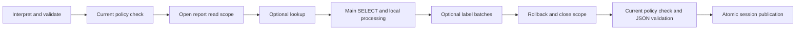

# Phase 11 — SQL Server reliability and multi-read consistency

2026-10-27. The [consistency contract](SDK_READ_CONSISTENCY.md) defines the approved
slice. The [versioned verification record](../evaluations/phase11/verification.v1.json)
identifies actual environments, scenarios, source/artifact bindings and commands.
The [real SQL Server procedure](PHASE11_SQLSERVER_TESTING.md) remains separately
gated. Phase 12 is not started.

## 1. Executive summary

The original implementation can combine an aggregate from one committed state
with labels from another. A controlled real SQLite schedule reproduces a
Changed/10 result although the two committed states were Ada/10 and Changed/99.
This is a data-read consistency risk, not a model-planning failure.

Hosts can now request `read_consistency="snapshot"`. One request-local executor
covers lookup, main query and all label batches on one connection/transaction;
cleanup must succeed before publication. Unsupported capability never falls
back. Default `"compatibility"` execution retains its connection behavior and
now labels that limitation explicitly in new artifact provenance. Existing
receipts/artifacts are not rewritten.

Actual SQLite concurrency and resource tests verify the new boundary. Fake SQL
Server tests verify scope routing, preconditions, timeouts/cancellation flow and
cleanup. A real-driver suite and strict approval validator are prepared, but
**Real SQL Server execution remains unverified.** No target, authentication,
operations or fixture/network/cleanup authorization was supplied. Production
readiness is not inferred from mocks or SQLite.

## 2. Verified starting baseline

Started on `main`, HEAD `b74c10974265dcac522b3e23623e0f4f9a8ae582`, empty index,
17 tracked modifications and 205 untracked files. Before edits, all 335 nonignored
repository files were copied/hashed under `dist/phase11/starting/`. The actual
Phase 10 SDK package source digest was
`74ee880e1af76afc317501b51528beba663a42c674895dfc3f146b20c4925fe1`.
Initial pytest reproduced **2,128 passed / one opt-in SQL Server skip**, 63.59 s.

Existing source changes were retained. Every original phase report, frozen
corpus, expected outcome, scorer/reference, measurement, disabled live packet and
Phase 10 matrix retains its bytes. Actual implementation changes are separately
listed against the starting hash ledger. No ignored production configuration or
Rahtal evidence was read. First failed implementations/probes remain under
`dist/phase11/`; passing reruns use fresh output paths.

## 3. Actual database execution architecture

| Operation | Existing/default data connections | Snapshot mode |
|---|---|---|
| Entity-name lookup, when selected | One disposable execution | Same scope connection |
| Main report | One disposable execution | Same scope connection |
| Entity-label enrichment | One execution per batch | Same scope connection for every batch |
| Registered dimensional relationships | Inside main SQL | Inside main SQL |
| Period comparisons / complete decrease candidates | One main SELECT/UNION | One main SELECT/UNION |
| Decrease ranking / comparison changes / presentation | Local result processing | Local processing within read boundary as needed |

Label batches use `min(100, max_rows)` identities. A simple aggregate has one data
SELECT; a lookup plus labeled report can have three or more. SQL Server also
issues source metadata checks per execute; SQLite checks each source's object
and columns. Snapshot SQL Server adds one bounded current-session/database
capability SELECT. These statements are counted separately from business reads.

Default mode uses the same logical sequence with separate adapter executions.
There is no database transaction during model calls or while waiting for a later
chat turn. SQLite session storage uses separate short BEGIN IMMEDIATE transactions
for claim/complete/get; those are not the reporting-data snapshot. Host policy
callbacks and model infrastructure may use their own connections and are not
implicitly part of this scope.

## 4. SQL Server isolation analysis

The old adapter inherits autocommit/isolation from its factory, verifies metadata,
executes one canonical query, then rolls back and closes. Separate executes do
not share a transaction. Plain READ COMMITTED does not establish a report-wide
point-in-time view; RCSI versions individual statements. SNAPSHOT needs both
enabled database support and the selected transaction isolation level.
[Microsoft's row-versioning guide](https://learn.microsoft.com/en-us/sql/relational-databases/sql-server-transaction-locking-and-row-versioning-guide)
distinguishes these guarantees.

The chosen SQL Server design uses a separate host-prepared snapshot factory. It
must return a fresh dedicated manual-commit lease with SNAPSHOT set through the
driver before SQL. The SDK verifies `autocommit is False`, isolation level 5 and
current database snapshot state 1; RCSI alone, disabled/transitional/unverifiable
states fail closed. The adapter does not enable database options, issue T-SQL
transaction-control commands or adopt an existing application transaction.
[Microsoft's ODBC transaction guidance](https://learn.microsoft.com/en-us/sql/relational-databases/native-client/odbc/performing-transactions-in-odbc)
supports using driver rollback for this manual transaction. Factory freshness,
finite login timeout, eligible sources and pool reset/discard remain host duties.

Automatically selecting SERIALIZABLE or changing row-versioning settings was
rejected as a host workload/configuration decision. A BEGIN wrapper around old
execute calls was rejected because those calls would still open independent
connections and end their transactions. One database transaction cannot certify
unrelated connections, linked servers, external/nonversioned sources or arbitrary
cross-database views. Concurrent schema changes can still fail; historical schema
metadata consistency is not promised.

## 5. Implementation and compatibility

`sdk/consistency.py` implements private, thread-confined executors and cleanup
contexts. They reuse canonical compilation, source-schema validation, row/type
validation and SQLite's registered-source authorizer. No SQL text is accepted
from a model/browser. `adapters.py` adds `read_scope` to each built-in adapter and
the optional SQL Server `snapshot_connection_factory`; ordinary execute behavior
is retained. `models.py` adds only fixed safe diagnostic reason/field vocabulary.

`engine.py` adds the keyword-only host `read_consistency` option and routes every
contributing read through one selected executor. Resource cleanup completes
before report state mutation/publication. New provenance identifies either mode.
The model/provider protocol, ReportSpec, catalog/policy contracts, calendars,
report fields/rows, session schema, execution opt-in and runtime dependencies are
unchanged. Custom execute-only adapters remain valid in compatibility mode;
snapshot adapters must implement the explicit context-manager capability.

Strong-mode request fingerprints prevent a cached compatibility receipt from
claiming a snapshot. Snapshot-mode saved retrieval refuses older/compatibility
artifacts; a new request ID executes under the stronger guarantee. Default
fingerprints remain compatible and old receipts keep their original payload.
The provenance marker is an intentional additive JSON change on new reports,
not a rewrite of historical evidence. `generated_at` remains artifact generation
time, not an asserted database snapshot timestamp/LSN.

## 6. Concurrency evaluation

The reproducible [offline probe](../tools/probe_read_consistency.py) executes
seven controlled schedules in each mode: unchanged data, committed update,
rolled-back update, insert, delete, cancellation between reads and injected
failure before labels. The independent writer commits at an explicit completed
aggregate checkpoint; no scheduling sleep is used as proof of a committed state.

All **14 contract checks** pass on measured final runtimes. These are not fourteen
correct business reports: compatibility update/delete deliberately demonstrate
read skew; compatibility conflicting-label insertion is safely rejected. Snapshot
mode returns the original coherent view for five successful schedules and
publishes nothing for cancellation/failure. One new request can see later data.
The record contains expected/actual synthetic outcomes, database/journal/driver
versions, BEGIN/rollback/connection/cursor observations and elapsed time.

Focused tests additionally cover lookup→aggregate→labels, three label batches,
two registered relationship sources, committed insert/delete/update versus
rollback, cross-thread misuse, replaced budgets/cancel events, cumulative VM
work, ambiguity, persistent replay, revoked access and publication failure.
SQL Server fakes prove one factory checkout and no intermediate rollback, not
actual MVCC behavior. They explicitly reject RCSI-only/disabled snapshot modes.

## 7. Actual SQL Server runtime status

**Real SQL Server execution remains unverified.** The twelve newly gated real
cases are skipped, in addition to the existing opt-in test. No server/driver
version or cleanup/cancellation success is invented. Local software inventory
finds pyodbc 5.3.0 and SQL Server/ODBC 17/ODBC 18 driver names; enumerating drivers
opens no connection and does not establish a connected driver/server version.

The prepared suite has a disabled manifest, pure offline approval tests, named
synthetic database/fixture restrictions, separate reader/writer/observer roles,
TLS validation, operation-specific write/timing/observation approvals and bounded
budgets. Host-seeded read-only checks are distinct from generated mutable
fixtures. Tests never create a database, change isolation options or grant rights.

When separately approved, the suite measures native scalar/Unicode/date/precision/
collation/policy behavior and controlled concurrency. Fixed timeout/cancel probes
require the appropriate SQLSTATE; arbitrary errors cannot count as success.
Cancellation waits for an actual server WAITFOR checkpoint using an approved
observer. Permission probes require SQL Server's denial code. Server-session
cleanup requires separately authorized DMV visibility, verified before declaring
zero sessions; otherwise server cleanup remains unverified. Host production
pooling is not certified by a fixture process with pooling disabled.

## 8. SQLite verification and minimum-runtime repair

Actual WAL-backed SQLite transactions establish one shared view while independent
writers commit. Transaction traces show one BEGIN/rollback and one closed data
connection in snapshot mode; default labeled reports normally use two separate
connections. Rollback-journal behavior differs: readers may block writer commits.
The SDK never changes journal mode and adds no in-memory/multi-file snapshot.
[SQLite documents these differences](https://www.sqlite.org/isolation.html).

The first actual installed Python 3.10 run exposed 28 failures: the new scope
used `set_authorizer(None)` to switch to trusted metadata/cleanup. On 3.10 that
does not disable authorization and subsequent statements fail. A minimal actual
3.10 probe reproduces `DatabaseError: not authorized`; a focused regression also
reproduces the pre-3.11 callback contract on newer interpreters.
[Python documents None support as added in 3.11](https://docs.python.org/3/library/sqlite3.html#sqlite3.Connection.set_authorizer).

The repair installs a callable trusted callback for fixed metadata/rollback and
the ordinary registered-source allowlist for canonical business SELECTs. File
mode=ro and query_only remain in force. Cleanup clears the progress handler
before rollback. This preserves Python >=3.10 instead of narrowing the advertised
range. Source-before/after artifacts and the failed installed run are retained.

## 9. Failure, cancellation and cleanup

Any failed read poisons its scope, even if a custom caller catches the exception.
A closed, failed or cross-thread executor cannot execute again. Request limits,
cancel identity and the overall deadline cannot be replaced/reset by later reads.
Each query still has its own bounded timeout; SQLite progress work is cumulative.
SQL metadata work must complete within the query deadline before the business
SELECT is allowed. A focused failing test caught and repaired that missing check
in the initial implementation.

Cursors close per statement. Rollback and connection close are attempted once
at scope exit; later cleanup is still attempted if an earlier step fails. A
cleanup failure prevents successful publication. Tests cover initial/probe/
metadata/main/subsequent failures, malformed labels, timeout/cancellation flow,
cursor/rollback/connection failure, ambiguity, revoked access and store failure.
They verify the previous report survives and failed replay performs no new reads.

Unexpected driver strings are not public errors. No failed query/transaction is
retried. Native driver/factory hangs, actual server cancellation and server-side
cleanup remain operational limitations requiring real integration evidence;
Python object cleanup is not promoted into a server-side guarantee.

## 10. Security and authorization

Current application policy is checked independently of the data snapshot before/
after contributing reads, after scope cleanup, before publication and on saved/
cached access. Revocation at scope cleanup is blocked before report publication.
The snapshot does not freeze permissions or make policy plus a separate session
store one atomic distributed transaction. Host freshness/reset contracts and
current access enforcement remain necessary.

Tenant/source policies, relationship cardinality guards, typed parameters,
read-only execution, result completeness, opaque references and model-data
isolation retain their contracts. There are no new formulas/joins/model stages,
permission expansion, identity inputs from browser messages or production writes.
Real SQL Server fixture writes are explicit test-only operations and have not run.

## 11. Resource and performance implications

Snapshot scopes occupy one connection/concurrency slot across all contributing
reads and bounded local processing. SQL Server may retain row versions longer;
SQLite WAL readers can retain WAL history, while rollback journals can block
writers. Hosts choose when the business guarantee justifies those costs and must
provide workload, pooling and connection timeouts. No connection is held during
model interpretation or between conversational turns.

Measurements in the machine record are small synthetic schedule/test durations
and resource counts. They establish functional boundaries and closure, not
production throughput, version-store capacity, model latency/cost or a speedup.
No production benchmark or database-wide configuration change was attempted.

## 12. Regression and release verification

The complete starting baseline is reproduced. Final full suites pass **2,201
tests / 13 skips** on Windows development Python 3.12.0 (81.78 s), actual
Windows 3.10.22 with core floors (82.38 s) and Ubuntu WSL2 3.12.3 (94.56 s).
There are 73 new passing tests, twelve newly gated real SQL Server cases and
the existing integration skip. All 14 SQLite schedule probes and strict gates
pass on both final installed-package environments. Exact versions, commands,
durations and source bindings are retained in the verification manifest.

Historical gates retain strict61/61, held-out30/30, Phase04 26/26, Phase05 37/37,
Phase06 all45/45 with36/36 reports, Phase07 27/27 with24/24, corrected Phase08
14/14 with16/16, and Phase09 13/13 with18/18. Original Phase03 remains40/42,
expected exit1 with only D02/D03. No expected outcomes or original/corrected
Phase08 script definitions were rewritten. Completed measured cohorts have no
incorrect accepted specifications or unauthorized reads.

The existing release helper now mandates the offline SQLite consistency probe.
The GitHub workflow stays offline/secret-free and strips SQL Server/evaluation
opt-ins; no real database job is enabled. Static actionlint validation and actual
local commands are distinct from hosted CI, which remains unexecuted.

Package imports now include 45 runtime modules. Fresh installed-wheel examples,
snapshot probes, wheel/sdist inventories, dependency checks and source/installed
byte bindings are verified separately. Final archive hashes/inventories and
defined repeated-build comparison live in ignored
`dist/phase11/final-verification.json` to avoid self-embedding archive hashes.
The report/matrix bind earlier measured artifacts to the same final SDK source.

## 13. Remaining risks

Compatibility mode still permits read skew and must not be sold as a snapshot.
Hosts must explicitly request stronger consistency when required. The SDK cannot
prove factory freshness, production pool reset or all underlying behavior of a
trusted external/cross-database view. Real SQL Server types, isolation, driver
cancellation, cleanup, version-store effects and resource limits remain incomplete.
The prepared integration suite itself still needs an approved native execution.

SQLite/SQL Server snapshots are different mechanisms; local success does not
certify SQL Server. No atomic distributed authorization/session/data transaction
or unrestricted cross-source snapshot was added. Full Phase10 cross-version
coverage is historical evidence, not a claim that every Python/driver combination
has been rerun for this changed SDK. Live-model generalization remains unverified.

## 14. Phase 12 recommendation — not started

The highest-value next step is explicit authorization of an isolated SQL Server
target and execution of the existing prepared suite, rather than another fixture/
approval preparation phase. Require independently checked native types/results,
correct snapshot versus compatibility schedules, transparent unsupported modes,
bounded cancellation/timeout, observed server cleanup where approved and no
residual synthetic fixtures. Test production pooling/reset separately before
claiming that deployment guarantee. A real-model baseline also remains valuable
after its own separate authorization; no external model call is authorized here.

## 15. Git and proposed commit

Branch/revision/index are unchanged. Prior source edits remain, and the starting
ledger identifies intentional changes separately from additive source/tests/
documents/evidence. Agent entry points and affected SDK extension guides link the
new contract. All original Phase01–10 reports/frozen inputs/measurements remain.
No reset, clean, rebase, commit, push, package publication or infrastructure change.

Proposed commit message:
`feat(sdk): add explicit snapshot scopes for multi-read reports`
