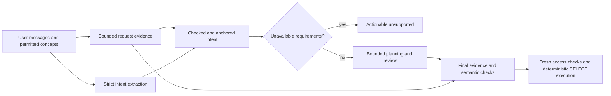

# Reporting reliability — Phase 3

Implemented and evaluated on 2026-10-15. This phase improves correctness and
failure handling within the existing registered reporting scope. It does not
make arbitrary natural-language reporting infallible or add analytical operations.

## Outcome and scope

The exact ten original Rahtal questions were rerun through the configured model,
public SDK, actual policies and SQL Server. Independent verification classified
**6 PASS and 4 UNSUPPORTED**. No incomplete result was counted as PASS. Before/after
bounded reference snapshots were identical. The supported monthly-only part of
Test 08 was evaluated separately and passed; it does not replace the original
full request's unsupported outcome.

The implementation requires explicit request evidence to constrain intent and
accepted specifications, records requested unavailable operations, prevents
unproductive repetitions, provides bounded structured-output repair, and exposes
safe failure-stage/reason/field metadata. Execution, authorization, deterministic
SQL and the existing calculation boundaries remain mandatory.

Non-goals: absence queries, arbitrary percentage shares/formulas, partitioned
rankings, computed series-extrema annotations, model-written SQL, new database
objects, broader access, timestamp conversion and automatic database retries.

## Investigation and root causes

The investigation used the source pipeline, the Phase 2 report and private
per-question replies, interpretation captures, diagnostic events and query
captures. Confidential source/result rows were processed locally for independent
verification; none were sent to a model or copied into this document.

| Finding | Root cause and evidence | Implemented boundary |
| --- | --- | --- |
| Test 02 accepted wrong named months | A structurally valid extracted intent/candidate could agree on wrong business periods. SQL validation proved consistency with that selection, not the original request. Phase 2 did not retain raw intent periods, so the exact earlier stage cannot retrospectively be identified. | Deterministic named-period/comparison evidence anchors extraction and gates the final specification independently of model approval. |
| Test 07 silently lost shares | Intent/spec fields represented supported selections, with no separate record of required unavailable outputs. A reviewer could approve the supported subset. | Typed unavailable-requirement ledger plus explicit operation evidence; reject the whole incomplete request transparently. |
| Test 08 repeated yearly/monthly conflict | The first interpretation was treated as an immutable foundation; only the planner was revised. The live intent schema also omitted the locally supported jalali_month grain. | Explicit grouping anchors, corrected schema, and one reconsideration of repeatedly conflicting intent; repeated unresolved conflicts terminate. |
| Tests 05/09 looped | Unsupported capability, missing business information and semantic disagreement shared an unproductive planning/review path. | Known unavailable operations are terminal before review; missing information remains clarification. |
| Repeat 06 invalid_interpretation was opaque | Parsing/shape/concept/constraint/calendar failures collapsed into one code with little stage detail. | Strict decoding with safe reason categories, field-level intent validation, and one optional repair shared across stages. The old rejected response cannot be reconstructed. |
| Tests 06/10 connection failures | Disposable connection acquisition failed before report execution. An unchanged later request could succeed. | Explicit connection-versus-execution stage metadata; preserve read-only cleanup and resource limits. No automatic query or connection replay was added. |

A further live monthly-only check encountered malformed period selection and a
planner revision. Investigation found a representation mismatch: a Persian named
month range was anchored as Gregorian range while prompts described the typed
Jalali range. The final anchor preserves inclusive Persian dates in jalali_range;
local calendar code resolves Gregorian bounds, consistent with the existing
calendar contract.

## Architecture and implemented decisions

### Request evidence and the final gate

The new evidence module recognizes bounded Persian/English whole named months,
English transliterated Persian months, Persian/Arabic digits, comparison order,
explicit named-month ranges and explicit daily/weekly/monthly/yearly grouping.
A year shared by two same-calendar named months is preserved. Missing years are
never inferred from the clock or assistant suggestions. A year-only answer can
complete the immediately preceding user's named period. Explicit mixed-calendar
comparisons with separately supplied years remain distinct typed selections.

Date-only numeric evidence supports explicit Gregorian inclusive/exclusive
endpoints, single-day requests and explicit inclusive Jalali ranges. Ambiguous
numeric calendars require clarification; Gregorian “to” without clear endpoint
semantics remains with interpretation/review. A monthly comparison is distinguished
from an additional monthly breakdown. An ordinary highest-bucket ranking remains
supported; it is not confused with computing both series extrema.

Exact, unambiguous host metric labels supplement the extracted metric list.
Longest overlapping labels take precedence; explicit removal and predicate forms
do not become output requirements. Synonyms and ambiguous labels still depend on
semantic interpretation. Label matches are indexed and processed by an interval
sweep rather than quadratic pairwise overlap checks on repeated input. No business measure vocabulary is embedded in the core.

Evidence repairs valid but contradictory intent before planning. It does not
silently rewrite a contradictory candidate into success: the candidate must pass
intent/evidence checks and review. Every provider, including the legacy single
interpreter and custom providers, also passes the engine's final evidence gate
after policy-bound preparation and before lookups/report queries. Existing
registration/type/access validation still runs, and a mismatch cannot execute.

### Completeness and unsupported operations

ReportIntent adds unsupported_requirements: a bounded tuple of public
UnsupportedRequirement(operation, evidence) records. The live strict schema
requires the array. Operations cover shares of totals, absence, partitioned
ranking, computed series extrema, unregistered calculations/operations and
comparisons beyond two periods. Evidence must be a literal quotation from user
text, bounded to 500 characters per item and eight items. It cannot be invented
or supplied by an assistant. Observer events record operation codes, not quotations.

Clear fa/en operation evidence can return unsupported with zero model requests.
Other wording/languages can use the typed ledger. The outcome explains the
unavailable operation and suggests host registration or an explicitly narrowed
request. It never executes an incomplete subset or asks whether the user permits
an unsupported operation. Existing advisory unsupported_reason is retained for
compatibility; it is not silently converted into a new capability.

This phase deliberately uses the existing unsupported status rather than adding
a partial-report status or fabricating missing fields. The absence of new generic
analytics is a scope decision, not a verification success. Registered participant
means, two-period percentage changes, entity declines, matching-day counts and
ordinary ranking retain their existing dedicated contracts.

### Bounded recovery and failures

max_revisions remains 0..3, default 1. The normal path is intent, plan and review.
After two repeated local intent conflicts, a backend supporting reconsider can
re-extract once using the original conversation/catalog and fixed conflict code.
Evidence and all ordinary checks are reapplied. A repeated unresolved conflict
terminates with intent_mismatch/repeated_conflict. No candidate, reviewer or
reconsideration can grant access or register an operation.

max_structured_repairs is a new optional 0/1 setting, default 0 for compatibility.
Rahtal explicitly enables 1. It permits at most one additional structured-response
request across intent, planning and review combined, with the same context and
original monotonic deadline. No raw rejected output/exception is echoed. Empty or
oversized output, invalid requirement evidence and transport failures are not
repaired. Failed repair does not reset the planning/elapsed-time budgets.
Without structured repair the maximum agent configuration remains bounded by nine
model requests; enabling it permits at most one extra. There is no automatic
retry of database execution. A deliberate new SDK attempt uses a new request ID;
completed receipts remain idempotent under current catalog/access checks.

SDKError preserves code/retryable and adds optional allowlisted stage, reason and
field values. Reply error JSON includes these only when populated. Examples are
intent/json_syntax, intent/concept_reference/metrics,
intent/intent_constraints/order_by, intent/period_selection/period,
planning/specification, review/review_shape,
database_connection/unavailable and database_execution/query_failed. Raw JSON,
unknown concept values, driver messages, credentials and connection fields are
not diagnostic metadata. Authorizations retain access_denied rather than being
reclassified as an unavailable analytical operation.

### Observability and privacy

Observer events now distinguish request evidence, decoded checked intent,
canonical corrections, effective intent, unavailable requirements, candidate
periods, conflict/reconsideration and structured repair. This exposes the first
stage where selected periods diverge. Candidate dates are logged only after
calendar validation; invalid date strings log only validity and the checked kind.
Filters, names, policy scalars, result rows and resolved identities remain excluded.
Field names/reason codes come from a fixed allowlist. Observer failures cannot
change reporting behavior. Rahtal's local diagnostic wrapper carries safe SDK
failure metadata and still excludes raw provider/driver exceptions.

## Affected components

| Component | Change |
| --- | --- |
| src/sageql/sdk/evidence.py | Request evidence, unavailable requirements/messages, intent anchoring and final provider-independent checks. |
| intent.py | Optional typed ledger and safe field/reason validation; existing complete selections and filters remain enforced. |
| agents.py | Ledger schema, Jalali grain, evidence normalization, bounded reconsideration/structured repair and stage observations. |
| provider.py | Shared strict object decoder; safe parsing/shape/transport/specification classifications. |
| engine.py | Final pre-execution evidence gate and additive safe error metadata. |
| models.py and SDK exports | Backward-compatible SDKError keywords and exported UnsupportedRequirement. |
| adapters.py | SQL Server connection, execution and cleanup stage classification; no SQL/policy/retry expansion. |
| sageql_rahtal/sdk.py and diagnostics.py | Explicit one-repair host setting and safe failure observations. |
| Tests and documentation | Public SDK regressions, updated expectations for earlier rejection and genuinely absent clarification details, API/usage documentation. |

## Automated verification and application independence

The new test_sdk_reliability.py exercises public SDK sessions, agents, actual
SQLite execution and policy-bound independent retail/library registrations using
fake model transport. Coverage includes wrong/ordered Persian and English periods,
mixed calendars, numeric date endpoints, monthly-versus-yearly disagreement,
missing metrics, unavailable requirements, unnecessary questions, fabricated
requirements, malformed intent/plan/review, a shared repair allowance/deadline,
root reconsideration, custom-provider bypass attempts, authorization before
shortcuts, no database replay, deliberate later recovery and conversation continuity.
Safe diagnostic fields and invalid-date redaction have explicit regressions.

Existing Rahtal, calendar, relationship, lookup, label, fixed-calculation, session,
CLI, adapter and frontend tests remain in the suite. A few test inputs that had
expected silent year guessing now supply the year, and clarification-cycle tests
use genuinely unspecified periods; the missing-year and supplied-year behavior
has separate new public-path coverage.

Final verification results and commands are recorded below. The ordinary
suite never calls the network. No new package dependency or application-framework
integration was introduced. The reusable package imports and runs the copied
standalone retail/library example from a fresh wheel environment with network
connections disabled and no repository/Rahtal imports. Both distribution formats
exclude local configuration, credentials and ignored evaluation reports.

## Before/after real evaluation

Same configured AvalAI endpoint/model gpt-5-nano, existing ODBC Driver 18
connection factory, trusted local reporting principal, business date 2026-10-15,
actual registered source policies, 100 output rows, 30-second query and 5-second
login bounds. No alternate database, fabricated model responses, source objects,
permission changes or business-record writes were used.

| Original test | Phase 2 | Phase 3 primary | Independent finding |
| --- | --- | --- | --- |
| 01 organization totals | PASS | PASS | Requested month, hours, count and participants match. |
| 02 monthly comparison | FAIL | PASS | Correct Shahrivar/Mordad bounds, totals, changes, percentages and direction. |
| 03 entity decline | PASS | PASS | Complete identity ranking, losses, percentages and policy-bound labels match. |
| 04 top ten | UNVERIFIED | PASS | Rolling period, aggregates, ordering and names match stable references in this run. |
| 05 absence | UNSUPPORTED, agent_exhausted | UNSUPPORTED | Actionable terminal reply; no model/database calls. |
| 06 current-position mean | BLOCKED | PASS | Fixed participant mean and current-position groups independently match. |
| 07 topics plus shares | PARTIAL | UNSUPPORTED | Whole request rejected transparently; no incomplete successful table. |
| 08 trend plus extrema | FAIL | UNSUPPORTED | Full request includes unavailable extrema annotations; monthly-only subrequest separately verified. |
| 09 within-entity winner/share | UNSUPPORTED, intent_mismatch | UNSUPPORTED | Required analytics remain unavailable; no clarification loop or reads. |
| 10 daily condition/count | BLOCKED | PASS | Filtered daily totals, names/dates and per-entity matching-day counts match. |

PASS is based on separately written bounded single-source SELECTs under the same
policies, independent Python arithmetic and the existing independent .NET
PersianCalendar oracle. It is not based solely on compiled SQL or reviewer approval.
Each of nine before/after reference reads was bounded by a 10,000-row sentinel
and finite query/login budgets; all completed without truncation. All three
source snapshots were identical between reference captures. Data was never sent
to an LLM for verification.

Each primary outcome is the first complete SDK submission of that exact original
question, including its explicitly configured bounded internal recovery. Tests 03
and 06 each used the single shared structured repair at intent constraints. Test
03's repaired intent reversed the periods; local evidence corrected the order
before planning. No separate whole-request diagnostic repeat replaced a primary
outcome. Historical Phase 2 retries retain their separate classifications.

The conversation follow-up to Test 01 also matched independent current-position
aggregates. The original request receipt remained equal after the follow-up with
zero additional provider/query calls, and its persisted report was retrievable.
Real actor probes denied another subject with the same role and the original
subject without the required role. This is the authorized broad local principal,
not a production per-manager/employee authorization or HTTP workspace-login test.

A supplemental request retained only Test 08's exact first sentence (monthly
hours/counts). Its first submission produced a complete independently matching
monthly table in 140.875 seconds, after one structured repair and one invalid-
period planner revision. It is a modified subrequest, not a PASS for original 08.
Final diagnostic/date-evidence refinements followed the primary calls; all six
accepted primary specifications were rechecked against the final evidence gate
without rerunning SQL or transmitting data. A separately recorded repeat of the
monthly-only subrequest passed in 65.672 seconds with one intent, one plan and
one review, no structured repair and no planner revision. It independently
matched a third fresh reference capture, identical to the earlier snapshots.
The initial supplement and this diagnostic repeat remain separate artifacts;
neither changes original Test 08's classification.

Private artifacts are under the ignored, current-user/SYSTEM-only directory
sageql_rahtal/reports/phase3_20261015. They contain exact questions, captures,
read-only reference queries/snapshots, expected values, comparisons, timings,
actor probes, package checks and diagnostic details. No confidential rows are
included in tracked documentation or fixtures.

## Performance observations

Primary aggregate wall time fell from 799.327 to 521.562 seconds; the median fell
from 71.054 to 59.5705 seconds. Model requests fell from 42 to 20 (six intent,
six plan, six review, plus two structured repairs). The four unsupported requests
finished in 0.25–0.265 seconds each, totaling 1.030 seconds and making no remote
model/database calls. No arbitrary analytics were implemented to obtain this gain.

Supported report durations were 62.219, 76.593, 142.375, 56.922, 76.985 and 105.438
seconds for Tests 01/02/03/04/06/10. The sample demonstrates removed failure loops,
not a latency SLA or a controlled model-speed benchmark. Remote reasoning remains
slow and nondeterministic; bounded repair can increase latency on malformed output.
No correctness check was removed to make the run faster.

## Compatibility, limits and next priorities

Existing ReportSpec, persisted session/report JSON, execution opt-in and SQL
operations are unchanged. Typed backends can omit the new ledger field through
its default; custom code strictly decoding ReportIntent.to_dict must accept the
new key. Model response fixtures/implementations of the live schema must populate
the array. SDKError additions are optional, and old code/retryable handling works.
Consumers should tolerate additive error metadata. No catalog change/session
migration is required by this phase.

Legacy two-method backends do not automatically gain a semantic requirement
ledger or independent intent extraction. They do gain the final bounded evidence
gate. Earlier custom providers that guessed a missing named-month year or ignored
explicit dates may now be rejected. This is an intentional correctness change.
Default structured repair remains disabled; Rahtal explicitly opts in.

The remaining limits are material:

- Bounded fa/en evidence recognizers are not a universal parser. Other wording,
  quoted business terms, negation, ambiguous metric labels and languages still
  depend on model extraction/review and can cause missed requirements or
  conservative refusal. A model-supplied ledger does not prove exhaustive NL
  understanding. This run does not establish unattended reliability for all requests.
- Model reconsideration remains fallible and bounded. Unsupported combinations,
  unavailable charts and legitimate contradictions can still end blocked rather
  than produce a report. A review approval alone remains insufficient evidence.
- Source/reference reads do not share an atomic cross-query snapshot. Stability
  checks detected no change here; future changing-source runs must retain
  UNVERIFIED when independent correctness cannot be established.
- Connection diagnostics do not repair external SQL Server availability. No
  infrastructure failure occurred in this primary run, but the network/driver can
  still fail. Host operations and deliberate new attempts remain necessary.
- Exact labels and known unavailable families improve completeness without
  expanding the execution language. General shares, absence, partitioned ranking,
  computed extrema and richer partial-report contracts need separate scope/design.

Recommended next work is a versioned host-extensible evidence vocabulary with
negation/quoted-literal handling, broader independent language evals with deliberate
requirement omissions, a reviewed public partial/completeness contract if desired,
snapshot-consistent verification where hosts support it, and provider-specific
latency/structured-output evaluation. Add new analytics only through separately
approved typed contracts and independent numerical tests.

## Final verification record

- Full offline suite: **1,381 passed, 1 skipped**. The skipped test is the existing
  optional synthetic SQL Server integration, not a substituted live success.
- New public SDK reliability file: **114 cases passed** across the retail/library
  hosts; existing Rahtal and historical-path tests also passed.
- Browser regression: tabs, history, failure handling, receipts, downloads and
  mobile layout passed. Nine actual report JSON artifacts rendered in desktop
  and mobile replay with external requests blocked and no page errors. Replay
  is rendering verification, not an HTTP authentication test.
- Wheel and sdist built using installed build dependencies with --no-isolation.
  Fresh-wheel isolated Python imports, public contracts and the copied standalone
  multi-domain example passed with socket connections disabled and no repository
  imports. Both archives exclude ignored reports, credentials and local config.
- Real evaluation: six independently verified primary reports; four transparent
  unsupported outcomes; verified follow-up/receipt/persisted access probes;
  separately verified first monthly-only supplement and diagnostic repeat.
- Final source review and git diff --check passed; existing working-tree changes
  were preserved. No business records/permissions/objects were changed and no
  commit was created.

Commands used (the real-service harness and references are private/ignored):

    .venv\Scripts\python.exe -m pytest -q
    .venv\Scripts\python.exe -m pytest -q tests/test_sdk_reliability.py
    .venv\Scripts\python.exe -m build --no-isolation --outdir <private-output>
    node tests/web_tabs.cjs
    git diff --check

Node used the existing bundled Playwright module path. The fresh-wheel check
used pip --no-index --no-deps with the already installed runtime dependencies;
no new dependency or remote service was needed. Normal isolated backend dependency
download was not tested in this phase.

Proposed commit message: fix(sdk): enforce request evidence and bound reporting recovery.
